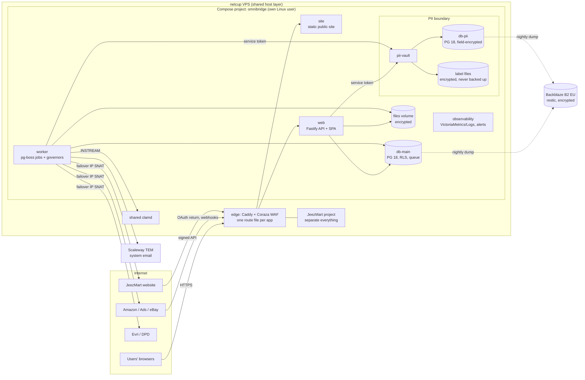

# OmniBridge architecture

Status: Phase A, revision 2. Owner: S1. This document records only decided items and the invariants that code must never break. The reasons behind each choice are in `docs/DECISIONS.md` (ADR-###). Requirement IDs refer to `docs/PRD.md`.

## 1. System in one paragraph

OmniBridge is a multi-tenant back office for UK multichannel sellers. One TypeScript codebase produces four processes:

- **web**: Fastify API under `/api` (ADR-060), which also serves the React SPA build (`index.html` for any other GET, except `/healthz`, `/webhooks/**` and `/connect/**`)
- **worker**: queue consumers and schedulers
- **pii-vault**: the only door to buyer PII
- **site**: the static public website

Two PostgreSQL 18 clusters sit behind them. `db-main` holds all business data with `workspace_id` on every row. `db-pii` holds buyer PII only, encrypted per field. Every call to an outside system (Amazon, Ads, eBay, carriers, websites) runs in a worker, through a durable pg-boss queue and a per-provider rate governor. Everything runs in Docker Compose on one netcup VPS in Germany, which is shared with JeezMart, plus a separate staging VPS.

## 2. Diagram: components, data flow and the PII boundary



The PII boundary: buyer PII enters only through `pii-vault`, which is the only process holding the `db-pii` credentials and the PII master key. Web and worker see opaque `pii_ref` UUIDs, masked strings, or a full record for one of the logged purposes (label creation, order detail, eBay inbox).

## 3. Repository layout (pnpm monorepo)

```
apps/web            Fastify API; serves apps/ui build; OAuth returns; webhooks; public API
apps/ui             React SPA (S2 owns design system and screens)
apps/worker         pg-boss consumers, cron, provider calls, PDF, imports/exports
apps/pii-vault      PII service (the only db-pii client)
apps/site           Astro public site
packages/contract   Zod route registry, OpenAPI generation, typed client
packages/core       money (Pence), time (UTC/London), TenantContext, errors
packages/db         main-DB migrations, Kysely types, repositories
packages/pii-db     PII-DB migrations (used only by pii-vault)
packages/crypto     envelope encryption (AES-256-GCM, DEK/KEK)
packages/queue      job envelope, policies, scheduler helpers
packages/governors/amazon   reactive token bucket (RL-1)
packages/governors/ebay     count-before-send budgets (RL-2)
packages/providers/*        adapters: amazon, ads, ebay, evri, dpd, website
packages/logger     pino with field allowlist and redaction
packages/files      FileStore interface + encrypted local implementation
packages/mail       SMTP adapter + templates
packages/testkit    fixtures, synthetic data with PII markers, route walker
mocks/provider-mocks  one Fastify mock server for all providers (dev/CI/staging)
infra/compose       compose.yaml (+ dev, ci, staging, prod overrides)
infra/edge          shared edge project (Caddy, WAF, clamd) + sites/omnibridge.caddy
infra/host          host bootstrap and hardening scripts
infra/backup        restic jobs and restore scripts
infra/observability configs for metrics, logs, alerts, Gatus
scripts/verify.sh   the single quality gate
docs/               PRD, architecture, decisions, plan, backlog, reviews, handoffs, ops
```

## 4. Decided stack

The full stack, with exact versions and licences, is the ADR table in `docs/DECISIONS.md` (ADR-001 to ADR-023). In short: TypeScript 6 on Node 24 LTS; Fastify 5 + Zod 4 contract → OpenAPI → typed client; React 19 SPA (TanStack, shadcn/ui on Base UI, Tailwind 4); PostgreSQL 18.6 ×2 with Kysely and forward-only migrations; pg-boss 12; in-house auth (argon2id, TOTP); Caddy + Coraza WAF; restic → B2 EU Central; Victoria* observability; Scaleway TEM email; Vitest, Testcontainers, Playwright, k6.

## 5. Invariants (code must never break these)

Each invariant names the check that enforces it. A change that needs to break one goes to S1 first, as a "Proposed" entry in DECISIONS.md.

**Tenancy and permissions**

1. **Every tenant table has `workspace_id`**, an RLS policy, and `FORCE ROW LEVEL SECURITY`. Foreign keys between tenant tables are composite `(workspace_id, id)`. Check: the `rls-coverage` SQL test. (TEN-1)
2. **The app connects as `ob_app`**, which has no BYPASSRLS. Migrations run as `ob_owner`. The worker connects as `ob_worker`, a member of `ob_app` (also no BYPASSRLS) whose only extra right is the audit purge (ADR-049). Only the scheduler fan-out uses `ob_platform`, which has read access to the workspace list and nothing else. (TEN-1)
3. **Every request runs inside one transaction, and every job uses only short transactions,** each of which sets `app.workspace_id` and `app.company_ids` with `SET LOCAL`. Repository functions require a `TenantContext` argument. No query is written without one. A provider job never holds a transaction across a network call: it reads and writes an intent row, calls the provider with no transaction open, then stores the result (ADR-054, FA-03). Check: lint rule plus type signature. (TEN-1, PERM-3)
4. **Every route in the contract declares** `auth` (public / session / platform / service / signed-webhook), `tab` and `adminOnly`, and whether it is company-scoped. The server refuses to register a route without them. The route walker calls every route as workspace A against workspace B's data, and as a child with no ticks. (AT-1, AT-2, SEC-3)
5. **Combined view means the user's permitted companies only.** It never means all companies in the workspace. (TEN-5, PERM-3)
6. **No workspace, company or account name appears in code**, schema or UI strings. Jeez, Sidson, Kyyz and JeezMart exist only in seed files. Check: a grep gate in verify.sh. (TEN-4)

**PII and deletion**

7. **Buyer PII never enters db-main**, logs, metrics, error events, exports, emails, notifications or main backups. The one exception is a CS-6 reply, emailed only to the Amazon relay domain (ADR-055). The only door is `pii-vault`. Check: a CI marker scan. Synthetic PII carries `PIIMARK-` markers, and the scan searches DB dumps, logs, captured emails and export files for them. (DP-8, AT-9)
7a. **No PII in queues or inboxes.** Job payloads, job results, idempotency records and webhook inboxes hold IDs and `pii_ref` values only. Inbound PII goes to the vault inside the request, before anything is queued. Check: the AT-9 marker scan includes the `pgboss` schema and `app.job_records`. (ADR-054, FA-04)
8. **pii-vault access is capability-scoped.** The capabilities are `ingest` (write), `read-full` (label, order detail, eBay and Amazon inboxes; each read logged), `mask`, `search` (blind index), `match` (same-buyer order IDs only, ORD-9; ADR-055), and `delete`. Masked strings are computed on request and never stored. (DP-7, ORD-5)
9. **PII is encrypted per field with AES-256-GCM**, using a per-workspace data key wrapped by the PII master key. That key lives only in pii-vault's Docker secret, never in a DB, an image or a backup. (DP-6)
10. **Deletion is a hard DELETE followed by VACUUM.** Each deletion writes tombstones in three places: db-pii, db-main (IDs only) and an off-site journal file. After any restore, the restore runbook applies every tombstone before the app starts. db-pii has no WAL archiving. (DEL-2, AT-8)
11. **Label files contain PII.** They live in the vault's volume, are never backed up, and are deleted at the earlier of 30 days or the order's PII expiry. Packing slips and merged print files are streamed and never stored. (P-005, SHP-6)

**Money, VAT and time**

12. **Money is integer pence (`bigint`)**, using the branded `Pence` type. No floats anywhere in money paths. VAT rates are basis points. Rounding is half-up and happens only at the points the PRD defines (VAT per rate group, VAT-3). Tests for these paths are written first and include property tests. (FIN-1)
13. **Times are stored as UTC `timestamptz`.** VAT dates are London dates and are stored as `tax_point_date` when the record is written. (NFR-7, VAT-1)
14. **Snapshots are immutable.** VAT rate, VAT type and COGS on an order line never change after the order is placed. (CAT-4, VAT-2, VAT-7)

**Integrations**

15. **No provider API is called outside `packages/providers`**, and no provider call is made from a web request handler except the OAuth code exchanges and the eBay webhook's cached public-key read (ADR-058). Check: dependency-cruiser rules. (INT-1, INT-2)
16. **The Amazon and eBay governors are separate packages** with no shared retry helper. The eBay budget is reserved before the call is sent, and nothing is sent at or above 95% of the cap. Check: dependency-cruiser rules plus the governor simulation tests. (RL-1–3, AT-7)
17. **Dev and CI never reach live providers.** The HTTP client refuses any host that is not on the mock allowlist unless `PROVIDER_MODE=live`, which is only set on production. Live behaviour is checked in explicit verify-live tasks. (Hard constraint 6, INT-7)
18. **No scraping or browser automation** of any marketplace or carrier site, ever. (INT-7)
19. **Every job carries** `workspace_id`, `channel_account_id` (when it has one), an idempotency key and an attempt count. Handlers are idempotent. (NFR-3)
20. **The kill switch and the maintenance switch are checked in the outbound pipeline**, just before any write to a provider. They are not checked only in the UI. (SAFE-2, SAFE-3)

**Operations and code quality**

21. **Every OmniBridge container has `mem_limit`, `cpus` and `pids_limit`.** OmniBridge joins only its own networks. Check: `scripts/check-limits.sh` in verify.sh. (OPS-8, OPS-10)
22. **No secret appears in the repo**, an image, a log or chat. Check: gitleaks in pre-commit and CI. Secrets reach containers only as Docker secrets. (SEC-5)
23. **Migrations are forward-only and expand/contract.** Each one must work with the previous app version still running. Check: squawk lint, plus a test that applies the migration to a seeded database from the previous release. (OPS-3)
24. **The ID coverage check passes.** Every test title cites the PRD IDs it proves, for example `[VAT-3]`, and `scripts/req-coverage.mjs` checks the mapping. Merging to `main` requires a PR and green CI; the session that opened it merges it (ADR-053). The human gate is Hashir's "go" on high-risk work and his approval of each production deploy. (SEC-16, Q-001)

## 6. Key designs

### 6.1 Tenancy (ADR-006)

Isolation is enforced in three layers:

- **Data-access layer:** a TenantContext is required in every call (invariant 3).
- **PostgreSQL:** RLS policies, plus composite foreign keys (invariants 1–2).
- **Route layer:** permission metadata, plus the route walker test (invariant 4).

Company scoping for child users uses a second RLS policy on tables that have `company_id`. Tab checks happen at the route layer. Dashboard caches are keyed by `workspace_id` plus a hash of the user's company set (NFR-6).

### 6.2 PII vault and deletion (ADR-007, M04)

pii-vault is a small Fastify service on the `ob_pii` network, and only it can reach `db-pii`. Web and worker reach it over `ob_app`, using per-caller service tokens that carry capabilities.

- **Search** (ORD-2, DEL-4) uses blind indexes: HMAC-SHA256 of the normalised postcode, email, phone and name, under a per-workspace index key.
- **Hourly expiry job:** deletes PII whose `delete_after` has passed. `delete_after` is delivery (or dispatch) + `pii_expiry_days`, default 25 (PRD v1.2, P-010), so backups are clear by day 30.
- **Event-triggered deletions:** cancellation, GDPR erasure, eBay account deletion, Amazon revocation, eBay termination and workspace closure all go through the same deletion service (DEL-1). Each run is logged with counts and IDs, never values (DEL-3).

### 6.3 Auth (ADR-008)

- **Passwords:** argon2id, with the USR-3 policy (offline breached-password filter, last 10 not reused, minimum and maximum age, name check).
- **MFA:** TOTP is mandatory before any workspace access. There are 10 recovery codes, stored hashed.
- **Lockout:** the hard USR-5 lock (10 failures in 15 minutes locks for 15 minutes), plus per-IP progressive delays, plus an alert on every lock.
- **Sessions:** a 256-bit random token, stored as a SHA-256 hash, with a 30-minute idle limit and a 12-hour absolute limit. Revoked on permission change or removal (USR-8).
- **Cookies and CSRF:** cookies are `Secure; HttpOnly; SameSite=Strict`. CSRF uses an Origin check plus a double-submit token.
- **Platform admins:** a separate flag, with `/platform` limited to VPN IP addresses (PLAT-1).

### 6.4 Queue and rate governors (ADR-009, ADR-010)

- **Queue:** pg-boss queues per job type.
  - Per-account serial work uses `key_strict_fifo` keyed by `channel_account_id`.
  - The cap of 4 parallel requests per carrier or website account (RL-4) is a PostgreSQL-backed semaphore.
  - The dead-letter queue and redrive are exposed in the platform console (M05).
- **Amazon governor:** token buckets per seller and operation, stored in PostgreSQL. On a 429 it backs off with full jitter (base 1 s, maximum 60 s, 8 attempts), then requeues. It reads `x-amzn-RateLimit-Limit` when present.
- **eBay governor:** reserves budget with an atomic `UPDATE … WHERE calls + n <= cap` in `api_usage`, keyed by API and US/Pacific day, before every send.
  - Non-urgent work stops at 80% of the cap, everything at 95%.
  - Each listing has a revision counter that alerts at 200 and holds writes at 240.

### 6.5 Providers and mocks (ADR-011)

Adapters implement `ChannelAdapter`, `AdsAdapter` and `ShippingProvider` (SHIP-3).

- Every response is validated with a versioned Zod parser. Unknown fields are ignored. A missing field raises a parser alert (INT-5).
- `mocks/provider-mocks` is written from the official specs. Its responses are checked against the official OpenAPI models where they exist.
- The mocks expose scenario switches: 429 storm, INVALID parcel, `invalid_grant`, revocation, and eBay cap exhaustion.

### 6.6 Files (ADR-012)

`FileStore` stores encrypted blobs under random IDs. Downloads use HMAC-signed links valid for 5 minutes, issued only after a permission check (NFR-5).

- **Attachments** are scanned by the shared clamd before they become readable (SEC-2, EXP-6).
- **Labels** are stored by pii-vault (invariant 11).

### 6.7 Secrets (ADR-014)

- **Infra secrets** (DB passwords, master keys, SMTP and B2 keys) are SOPS/age-encrypted in the private ops repo. They are decrypted on the server into Docker secrets on tmpfs, and each is mounted only into the containers that need it.
- **Provider tokens and app secrets** (PLAT-4) are envelope-encrypted in db-main under the secrets master key. They have `current` and `next` slots (AMZ-10, AMZ-8).
- **Register:** `docs/ops/secrets-register.md` lists each secret's owner and rotation date (SEC-5, SEC-6).

## 7. Shared server and deployment (ADR-015, ADR-024)

### Isolation (OPS-8, OPS-9)

OmniBridge has its own Linux user `omnibridge`, directory `/srv/omnibridge`, Compose project `omnibridge`, networks (`ob_edge`, `ob_app`, `ob_db` and `ob_pii` internal, `scan_ob`), secrets, backups and deploy pipeline. Module order is in `docs/plan/MODULES.md`; tasks are in `docs/backlog.json`.

### Shared host layer (P-004)

The shared layer is owned by the `edge` project (Linux user `edge`). It contains:

- Caddy + Coraza WAF, with `import sites/*.caddy` so each app owns one route file
- the single shared clamd (each app reaches it on its own network)
- host security: WireGuard, SSH key + TOTP, nftables default-deny, auditd, AIDE, fail2ban, unattended-upgrades

### Fixed IP (OPS-2)

All carrier and website egress leaves through a netcup failover IPv4 using an nftables SNAT rule. Carriers allowlist that address, and it can be moved to a replacement server.

### Deploy (OPS-3)

1. GitHub Actions builds the images, runs tests and scans, and pushes to GHCR.
2. Staging deploys automatically.
3. Production deploys after Hashir approves in the GitHub Environment.
4. The deploy runs as a forced-command user, reached over WireGuard.
5. Migrations run first, as a one-off container.
6. The idle web colour starts and passes health checks.
7. The old colour drains. Workers stop gracefully, then the new ones start.

### Resource budget: production netcup VPS 2000 G12.5 (8 vCores, 16 GB, 256 GB)

| Item | Today | Design (§9.1) |
|---|---|---|
| Host layer | 1.0 GB | 1.0 GB |
| Shared clamd | 1.4 GB | 1.4 GB |
| JeezMart (assumption) | ≤3.0 GB / 2 cores | ≤3.0 GB / 2 cores |
| OmniBridge web | 1×384 MB / 1.0 | 2×448 MB / 2×1.0 |
| worker | 1×512 MB / 1.0 | 2×640 MB / 2×1.0 |
| pii-vault | 96 MB / 0.25 | 160 MB / 0.5 |
| db-main | 1,536 MB / 1.5 | 2,560 MB / 2.0 |
| db-pii | 256 MB / 0.5 | 384 MB / 0.5 |
| site | 24 MB / 0.1 | 24 MB / 0.1 |
| observability (9 containers) | 488 MB / 0.75 | 500 MB / 0.75 |
| **OmniBridge sum** | **3,296 MB ≈ 3.3 GB** | **5,804 MB ≈ 5.7 GB** |
| Transient (backup 384 + deploy overlap ≈450 + migration 192) | ≈1.0 GB | ≈1.0 GB |
| **Combined worst-case peak** | **≈9.7 GB** | **≈12.1 GB** |

The rest of the RAM is page cache. Swap is a 2 GB file with `vm.swappiness=10`, and any swap use raises an alert. Every container gets an alert at 80% of its memory limit.

**PostgreSQL settings:**

| Setting | db-main today | db-main design | db-pii |
|---|---|---|---|
| shared_buffers | 384 MB | 640 MB | 64 MB (96 MB at design) |
| effective_cache_size | 1 GB | 1.75 GB | 160 MB |
| work_mem | 8 MB | 12 MB | 4 MB |
| maintenance_work_mem | 96 MB | 128 MB | 32 MB |
| max_connections | 40 | 60 | 15 |

Pool sizes: web 10, worker 8, vault 4. Every cluster also uses `random_page_cost=1.1`, `effective_io_concurrency=200` and `max_wal_size=1GB`.

### Disk
The design horizon uses about 166 GB of 256 GB: OS 10 GB, Docker images 15 GB, db-main 45 GB, db-pii 3 GB, files 25 GB, VictoriaLogs 15 GB, VictoriaMetrics 3 GB, restic and dumps 10 GB, JeezMart 40 GB. Disk alerts fire at 70% and 85%. Upgrade triggers are in `docs/ops/runbooks/server-upgrade.md`.

**Staging** is a netcup VPS 1000 G12.5 (8 GB) running reduced limits and the provider mocks. It holds synthetic data only (SEC-7). AT-25 and the first AT-24 drill run on production before go-live, while it still holds no real data.

## 8. Backups (ADR-016)

- **Schedule:** a nightly `pg_dump` of each cluster goes to restic and then to Backblaze B2 EU Central. Main and PII have separate buckets, application keys and restic passwords.
- **Ransomware protection:** the keys on the server cannot delete files, only hide them. Lifecycle rules remove hidden files after 14 days (main) or 1 day (PII). `forget`, `prune` and `check` run only from a protected GitHub Actions environment.
- **Retention:**
  - Main: 7 daily + 4 weekly + 6 monthly. Any account-level deletion run triggers a purge of all older main snapshots, because Amazon requires deletion from backups too.
  - PII: 3 daily snapshots (P-010).
  - Labels and other files in the vault volume are never backed up.
- **Drills:** a quarterly restore drill, with tombstones re-applied first (AT-24).

## 9. Observability (ADR-017)

- **Logs** pass a field allowlist and redaction in pino, then a second scrub in fluent-bit, and are kept in VictoriaLogs for 13 months (SEC-12).
- **Errors** are logged with a fingerprint and alerted through vmalert, which takes the place of a separate error tracker.
- **Alerts** cover errors, queue depth, dead-letter growth, disk, memory (80% of each container's limit), certificate expiry, backup age and swap use (OPS-4).
- **Uptime** is watched by Gatus on each server plus one external check (P-011).

## 10. Testing strategy (ADR-018)

| Kind | Tool | Must cover |
|---|---|---|
| Unit | Vitest | Pure logic. Written first for money, VAT, deletion, tenancy and permissions. Money and VAT also get property tests (fast-check). |
| Integration | Vitest + Testcontainers PG 18 | Repositories, RLS, migrations, queue, vault |
| Route walker | testkit | Every contract route × (cross-tenant, child without ticks, anonymous) (AT-1, AT-2) |
| Contract | Vitest + provider-mocks | Adapter ↔ mock; mock ↔ official schema |
| PII marker scan | testkit | DB dump, logs, emails, exports (AT-9) |
| End-to-end | Playwright | Key journeys. UI screens are compared with S2 reference screenshots. |
| Load | k6 | §9.1 targets on the production box before go-live (AT-25) |
